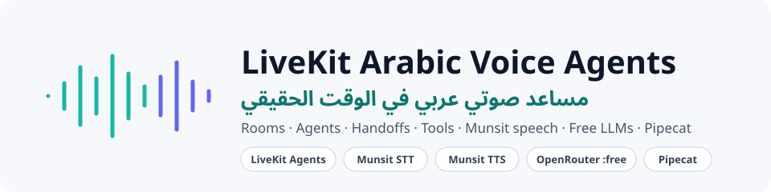
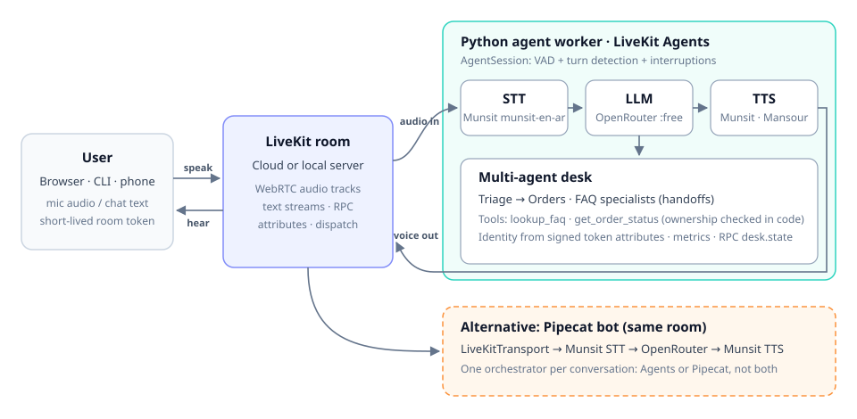
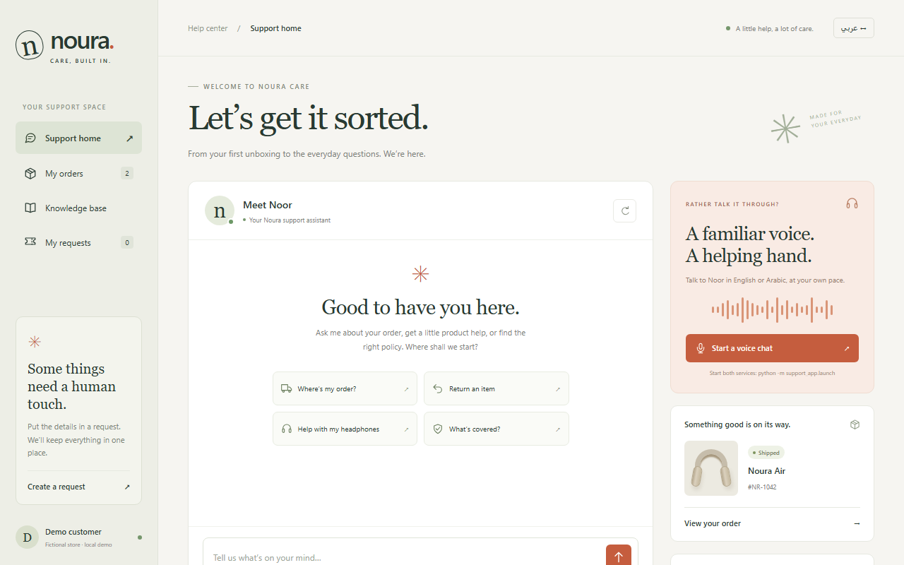

<p align="center">
  
</p>

<p align="center">
  
  
  
  
  
  
</p>

Build **realtime voice assistants that speak Arabic and English**, step by step. You start with a single LLM call and finish with a multi-agent support desk that hands conversations between specialists, checks who the caller is, and is covered by automated voice tests.

- 🎙️ **Arabic voice end to end**: Munsit streaming speech-to-text and an Emirati text-to-speech voice
- 🆓 **Free LLMs by design**: OpenRouter `:free` routes only, with zero-price ceilings enforced in code
- 🧭 **Multi-agent handoffs**: triage → orders / FAQ specialists with shared state
- 🔐 **Identity the model can't fake**: customer ID signed into the LiveKit token and checked inside tools
- 🧪 **Tests that talk**: offline unit tests, LLM-judged behavioural tests, and a voice smoke test that speaks into a real room
- 🐱 **Pipecat in the same room**: the same pipeline built with Pipecat on LiveKit transport

## Architecture

<p align="center">
  
</p>

LiveKit moves audio and data in real time. Your Python worker decides what to say. Each provider is swappable, and only the parts you enable cost anything.

## Quick start

```powershell
git clone https://github.com/hudasaleh97188/livekit-voice-agents.git
cd livekit-voice-agents
python -m venv .venv
.\.venv\Scripts\Activate.ps1          # macOS/Linux: source .venv/bin/activate
pip install -r requirements-livekit.txt
copy .env.example .env                 # then fill in your keys
python -m examples.check_config --voice --room
```

| Setting | Where to get it | Cost |
|---|---|---|
| `OPENROUTER_API_KEY` | [openrouter.ai](https://openrouter.ai) | Free models (50 requests/day, or 1,000 after buying 10 credits) |
| `MUNSIT_API_KEY` | [munsit.com](https://munsit.com) | Speech uses credits (trial credits available) |
| `LIVEKIT_URL` / `_API_KEY` / `_API_SECRET` | [LiveKit Cloud](https://cloud.livekit.io), or a local `livekit-server --dev` | Cloud free tier, or free locally |

`ENABLE_MUNSIT_BILLING=false` blocks every speech request, so you can work on agent logic without spending credits.

## The learning path

| # | Run | You learn |
|---|---|---|
| 1 | `python -m examples.openrouter_chat "Hello"` | One free LLM call, with the cost guard |
| 2 | `python -m examples.munsit_transcribe --voices` | Browse the Arabic voice catalogue |
| 3 | `python -m examples.livekit_text_agent dev` | An agent inside a LiveKit room (text only) |
| 4 | `python -m examples.livekit_voice_agent console` | STT → LLM → TTS with your own microphone |
| 5 | `python -m examples.livekit_tools_agent dev` | A voice agent that calls a knowledge tool |
| 6 | `python -m examples.livekit_advanced_agent dev` | Multi-agent desk: handoffs, identity, RPC, metrics |
| 7 | `python -m integrations.pipecat_livekit_bot --room demo` | The same idea with Pipecat |

Agents in `dev` mode wait for a dispatch. Join and talk to them from another terminal:

```powershell
# Text chat with an agent (fresh room, automatic dispatch)
python -m tests.live_room_smoke --agent tutorial-text "What is LiveKit?"

# The advanced desk as verified customer cust-amal, dispatch embedded in the token
python -m tests.live_room_smoke --agent tutorial-desk --customer cust-amal --token-dispatch --rpc `
  "Where is my order NR-1001?" "ما هو بريد الدعم؟"
```

## Advanced: the multi-agent support desk

[`examples/livekit_advanced_agent.py`](examples/livekit_advanced_agent.py) shows the patterns a production assistant needs:

| Technique | How |
|---|---|
| Agent handoffs | A tool returns another `Agent`; chat history moves with it |
| Typed shared state | `AgentSession[DeskState]` and `RunContext` in every tool |
| Verified identity | `customer_id` signed into token attributes, checked in [`orders.py`](examples/orders.py) |
| Dispatch in the token | `RoomConfiguration(agents=[RoomAgentDispatch(...)])`: the agent joins with the user |
| Live UI state | `desk.agent` participant attribute and a `desk.state` RPC method |
| Observability | Per-turn LLM time-to-first-token, token usage, and a session summary |
| Graceful failure | A bilingual "model is busy" reply instead of silence when free routes are rate-limited |

Example run against LiveKit Cloud:

```text
You: Where is my order NR-1001?
  [ui] active specialist -> orders
agent: Your order NR-1001 has been shipped. It is expected to arrive by October 21, 2026.
You: What is the support email?
  [ui] active specialist -> triage
  [ui] active specialist -> faq
agent: The support email is help@example.com.
RPC desk.state -> {'active': 'faq', 'handoffs': ['triage', 'orders', 'triage', 'faq'], 'verified': True}
```

## Noura Care: a complete support app

<p align="center">
  
</p>

A fictional UAE electronics store with an English/Arabic (RTL) frontend, grounded answers with source links, customer-scoped order lookup, saved tickets, and an optional LiveKit voice call. No build step and no Node.js are needed.

```powershell
python -m support_app --offline      # fully local, no provider calls
python -m support_app                # AI replies via free OpenRouter models
python -m support_app.launch         # also sets up and supervises the voice worker
```

Then open http://127.0.0.1:8080. More detail is in the [app guide](support_app/README.md).

## Pipecat on LiveKit

Prefer Pipecat's frame pipeline? [`integrations/pipecat_livekit_bot.py`](integrations/pipecat_livekit_bot.py) joins the same kind of LiveKit room with Pipecat 1.12. It supports text mode (JSON data packets) and `--voice` (Munsit STT/TTS with Silero VAD). Install it in a separate environment:

```powershell
python -m venv .venv-pipecat
.\.venv-pipecat\Scripts\python.exe -m pip install -r requirements-pipecat.txt
.\.venv-pipecat\Scripts\python.exe -m integrations.pipecat_livekit_bot --room demo
python -m tests.live_room_smoke --pipecat --room demo "Hello!"
```

Use one orchestrator per conversation: LiveKit Agents or Pipecat, not both in the same room.

## Testing

```powershell
python -m unittest discover -s tests -v                                  # offline, no credits
python -m unittest support_app.test_support support_app.test_launch     # support app

$env:RUN_LIVE_LLM_TESTS = "1"
python -m unittest tests.test_desk_behaviour -v                          # LLM-judged behaviour

python -m tests.live_voice_smoke --say "ما هو بريد الدعم الخاص بالورشة؟" --agent tutorial-tools
```

`live_voice_smoke` speaks a question (synthesized with your Munsit voice, or from a WAV file) as a microphone in a fresh room. It passes only when the agent transcribes it, answers, and sends back audible speech. A typical run:

```text
  you (STT): ما هو بريد الدعم الخاص بالورشة؟
  agent: عنوان بريد الدعم الخاص بالورشة هو help@example.com ...
audible agent speech received: 8.5s
PASS
```

## Project layout

```text
examples/        step-by-step agents, provider factories, token and dispatch helpers
integrations/    Pipecat pipeline and runnable LiveKit bot
support_app/     Noura Care web app, voice worker and its tests
tests/           offline tests, behavioural tests, live room and voice smoke tests
data/            fictional FAQ and order fixtures
assets/          README images
```

## Notes

- **Free models vary.** `openrouter/free` can pick a different model on each request, and free routes get rate-limited. Pin a `:free` model (`python -m examples.openrouter_chat --list-free`) when you evaluate behaviour.
- **Free quotas are small.** At the time of writing, OpenRouter allows 20 free requests per minute and 50 per day; a one-time purchase of 10 credits raises the daily limit to 1,000. Every voice turn, tool call, and handoff is a request, and so is every LLM-judge check.
- **Secrets stay server-side.** Browsers receive short-lived room tokens, never provider keys or the LiveKit API secret. `.env` is git-ignored.
- **All data is fictional.** Orders, customers, the store, and `help@example.com` are sample data for learning.
- These are teaching examples. Add authentication, monitoring, and a data-retention policy before handling real users.

## License

[MIT](LICENSE) © hudasaleh97188
